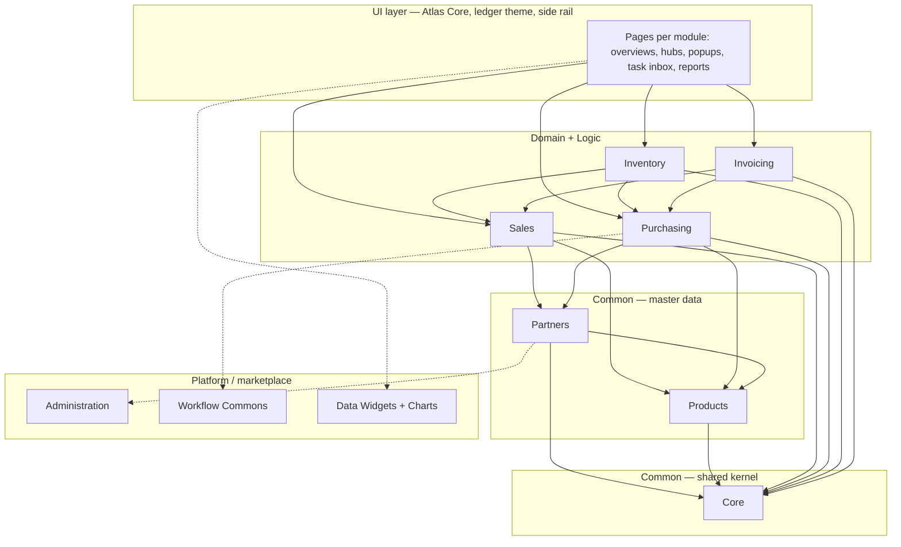
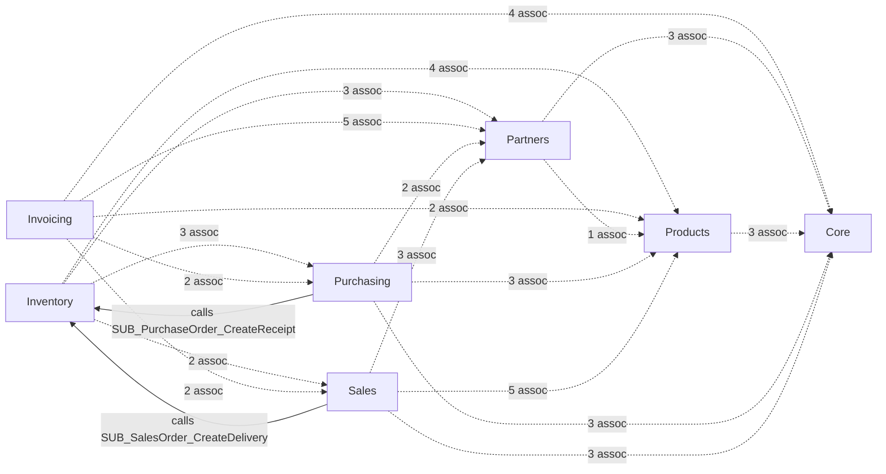
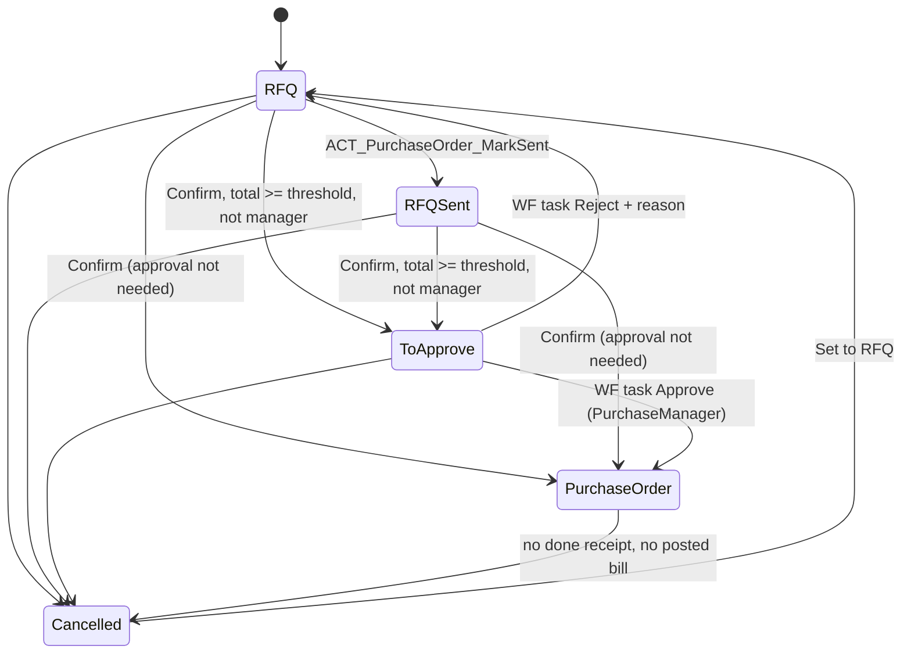
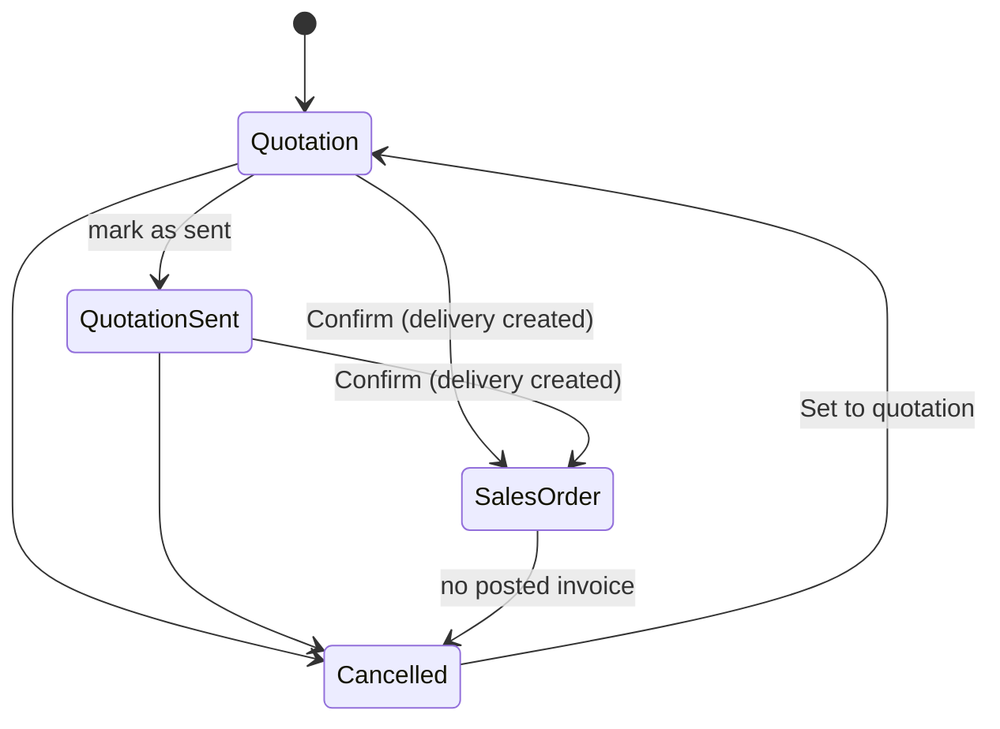
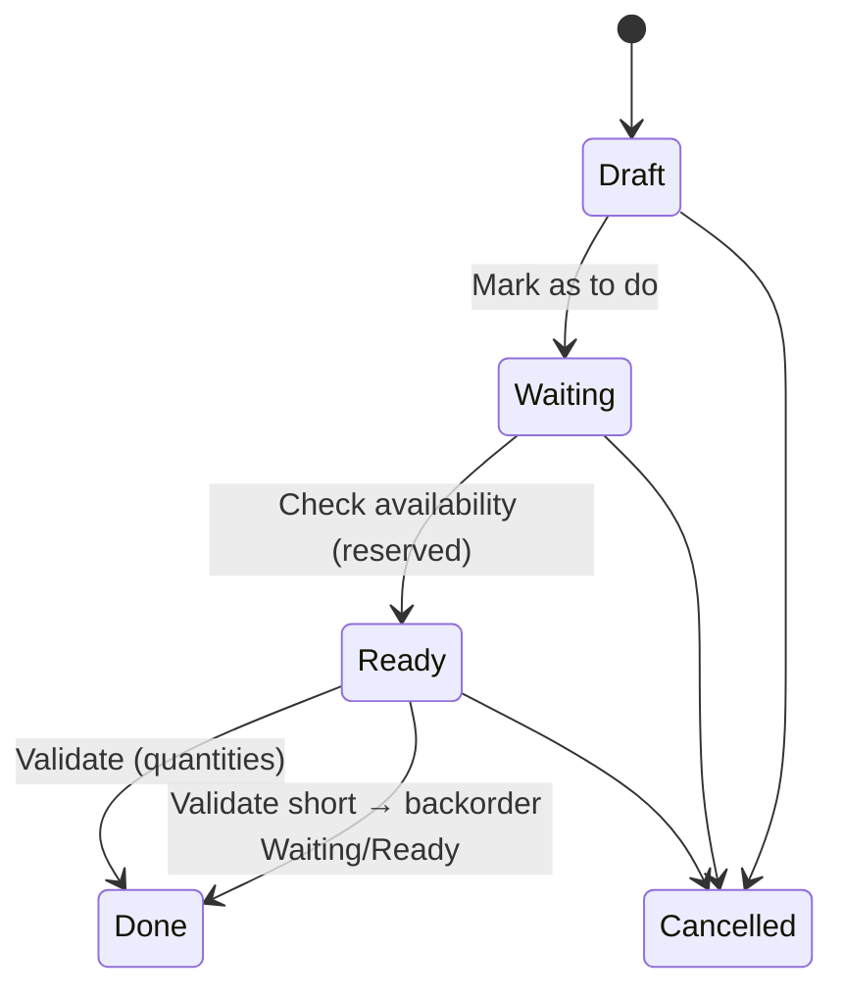
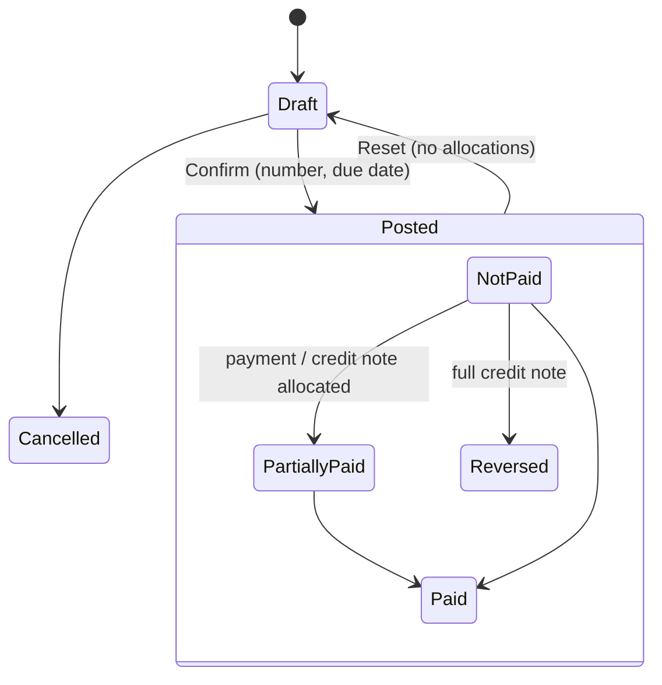
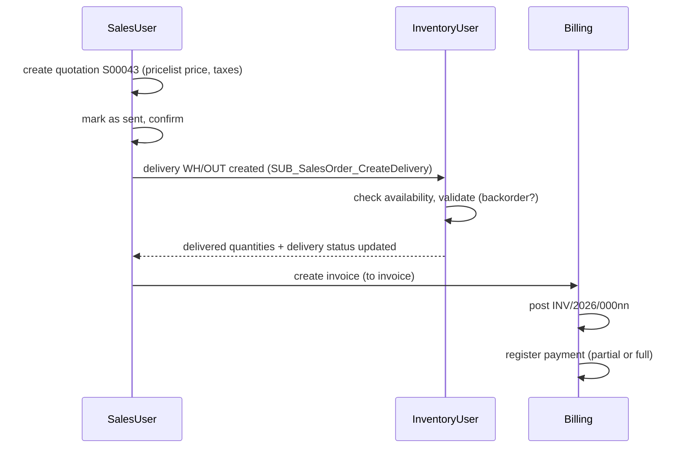
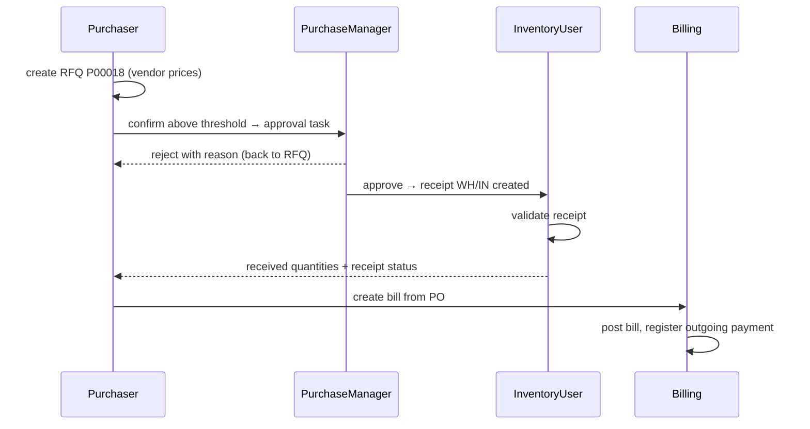
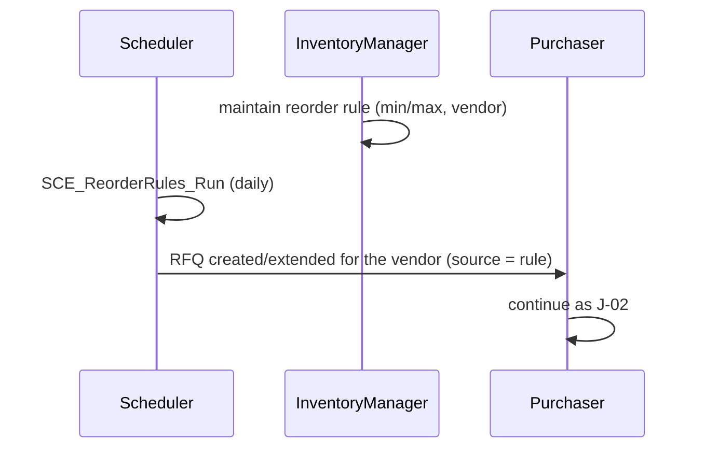
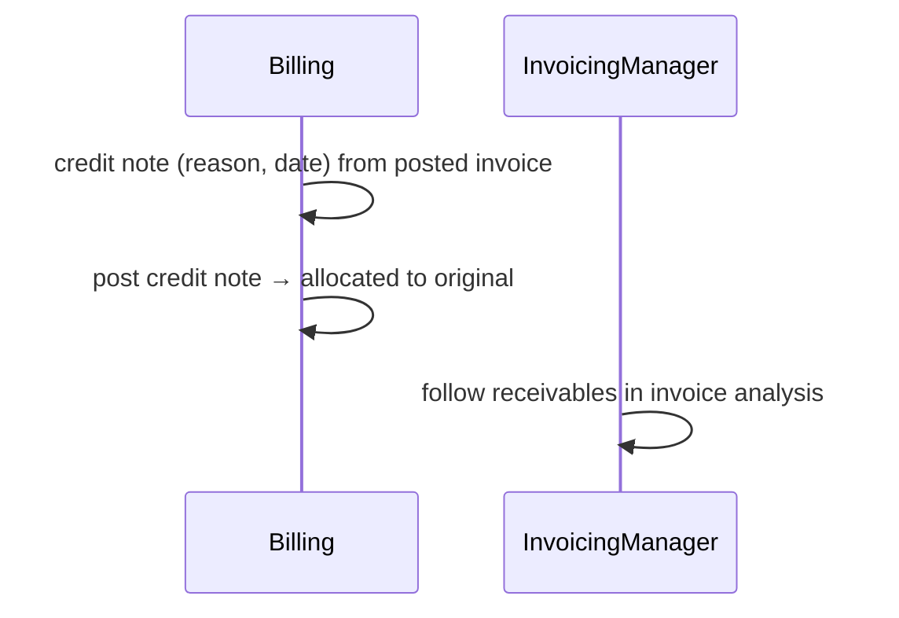

# Blueprint — erpv1

_Source of truth for the Stage 3 architecture. Generated by `pipelines/odoo/arch_blueprint.py` from the confirmed BRDs (`analysis/odoo/knowledge-base/brd/`), `module-graph.json` and `ui_spec.py`; `blueprint.html` renders this file._

**One Mendix 11.15 app, 7 modules, ledger theme, side-rail navigation.** Module rationale: `architecture/module-design.html`. ERD: `architecture/erd.md`.

## Tiers (layer view)

Arrows point down the tiers only. Associations are acyclic (checked by `brd_generator.py`); the only upward calls are the sanctioned bridges Sales/Purchasing → Inventory/Invoicing (user actions on an order).

## Module wiring (build-order view)

Dotted = cross-module associations (owned by the referencing module, created in that module's domain-model script). Solid = sanctioned upward microflow calls.
**Build order:** Core → Products → Partners → Sales → Purchasing → Inventory → Invoicing (the bridges in Inventory/Invoicing are built with those modules; Sales/Purchasing call them through stubs until then).

## Modules

| Module | Layer | Persistent entities | Microflows | Pages | Definition |
|---|---|---|---|---|---|
| Core | Common | 7 | 4 | 6 | [definition](modules/Core/definition.md) |
| Products | Common (master data) | 8 | 6 | 8 | [definition](modules/Products/definition.md) |
| Partners | Common (master data) | 4 | 5 | 4 | [definition](modules/Partners/definition.md) |
| Sales | Domain + Logic | 5 | 11 | 8 | [definition](modules/Sales/definition.md) |
| Purchasing | Domain + Logic | 3 | 14 | 6 | [definition](modules/Purchasing/definition.md) |
| Inventory | Domain + Logic (downstream) | 7 | 10 | 7 | [definition](modules/Inventory/definition.md) |
| Invoicing | Domain + Logic (downstream) | 4 | 11 | 7 | [definition](modules/Invoicing/definition.md) |

## Workflow and lifecycles (Step 3b)

### WF_PurchaseOrderApproval (Mendix workflow) and purchase order status

User task "Approve purchase order": assigned to PurchaseManager (module role Purchasing.Manager), outcomes Approve / Reject (reason required), inbox `PurchaseApproval_Inbox` (Workflow Commons), task page `PurchaseApproval_Task`. No timers, no parallel paths; one pool.

### Sales order status

### Transfer status

### Invoice status and payment status

## Cross-persona journeys (Step 3d)

| Journey id | Name | Personas involved | Modules touched |
|---|---|---|---|
| J-01 | Quote → order → delivery → invoice → payment | SalesUser, InventoryUser, Billing | `Sales`, `Inventory`, `Invoicing`, `Partners`, `Products`, `Core` |
| J-02 | RFQ → approval → receipt → vendor bill | Purchaser, PurchaseManager, InventoryUser, Billing | `Purchasing`, `Inventory`, `Invoicing` |
| J-03 | Stock below minimum → automatic RFQ | InventoryManager, Purchaser | `Inventory`, `Purchasing` |
| J-04 | Credit note for a posted invoice | Billing, InvoicingManager | `Invoicing` |

### J-01 — Quote → order → delivery → invoice → payment

### J-02 — RFQ → approval → receipt → vendor bill

### J-03 — Stock below minimum → automatic RFQ

### J-04 — Credit note for a posted invoice

## Security model (Step 6a)

Project security: production level; no anonymous/guest access; demo users one per user role.

| User role | Core | Products | Partners | Sales | Purchasing | Inventory | Invoicing |
|---|---|---|---|---|---|---|---|
| SalesUser | Reader | Reader | Editor | User | — | Reader | Creator |
| SalesManager | Reader | Manager | Editor | Manager | — | Reader | Creator |
| Purchaser | Reader | Reader | Editor | — | User | Reader | Creator |
| PurchaseManager | Reader | Manager | Editor | — | Manager | Reader | Creator |
| InventoryUser | Reader | Reader | Reader | Reader | Reader | User | — |
| InventoryManager | Reader | Manager | Reader | Reader | Reader | Manager | — |
| Billing | Reader | Reader | Editor | Reader | Reader | — | Billing |
| InvoicingManager | Config | Reader | Editor | Reader | Reader | — | Manager |
| Administrator | Admin | Manager | Admin | — | — | Manager | — |

Row-level: SalesUser sees own sales orders only (XPath on SalesOrder_Salesperson). Approval task only for PurchaseManager. Configuration pages (Company, Warehouse, Numbering, Taxes, Payment terms, UoM, categories) need the Admin/Manager/Config module roles.

## Volumes and NFRs (Step 6b)

Demo data: tens to hundreds of rows per entity; ≤ 5 concurrent users; no SLA (CONFIRMED 2026-10-14). Consequences: Data Grid 2 with paging (20 rows), no batching in microflows, indexes only on `Number`, date and `Status` attributes of SalesOrder, PurchaseOrder, Transfer, Invoice, Payment.

## Integrations (Step 6c)

None live. Email, portal, payment providers, EDI and barcodes are declared not implemented (Stage 0); no stubs needed because no flow calls them — the corresponding buttons are absent (e.g. "Send" only marks as sent).

## Fit-gap

See [fit-gap.md](fit-gap.md).

## Dependencies and open issues

Register rows OI-1…OI-5 in `PROJECT.md` (single decision register).
