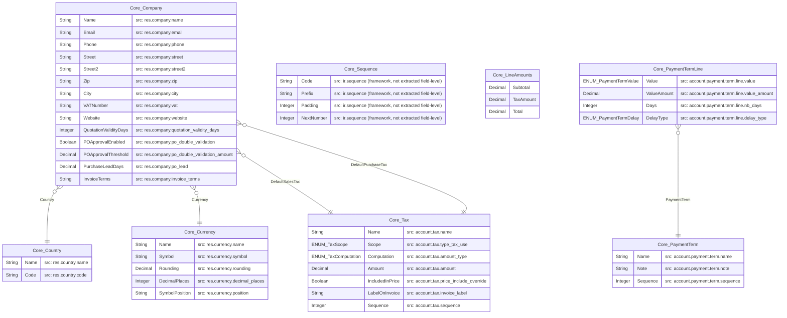
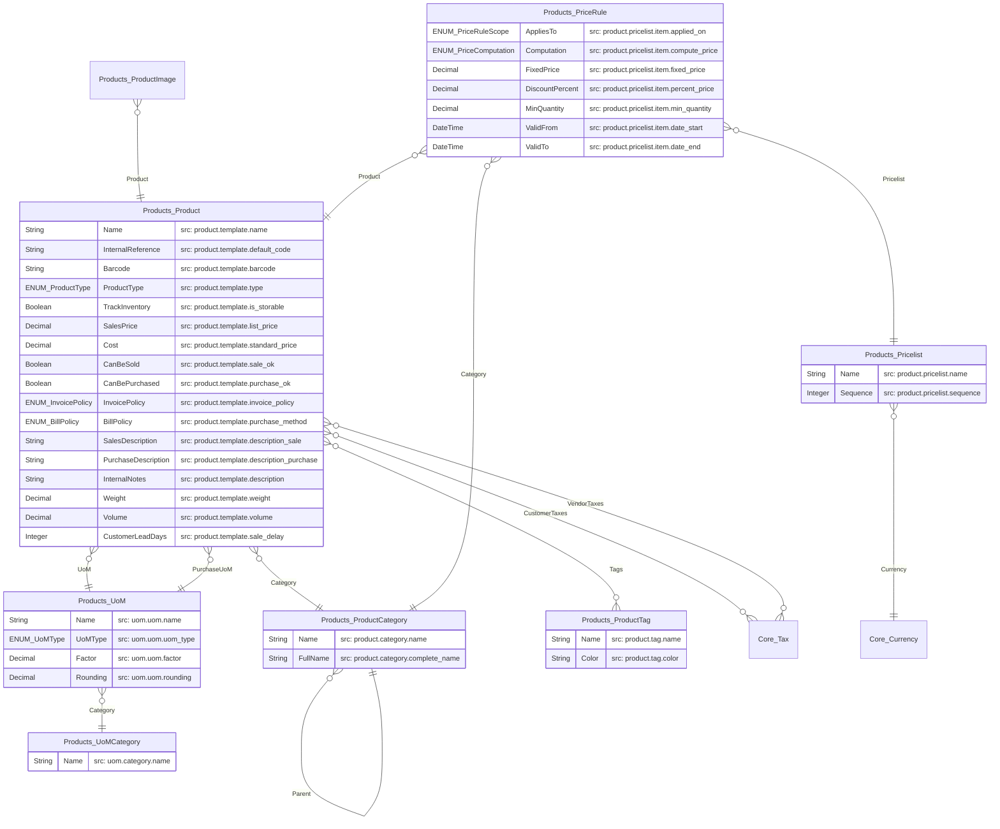
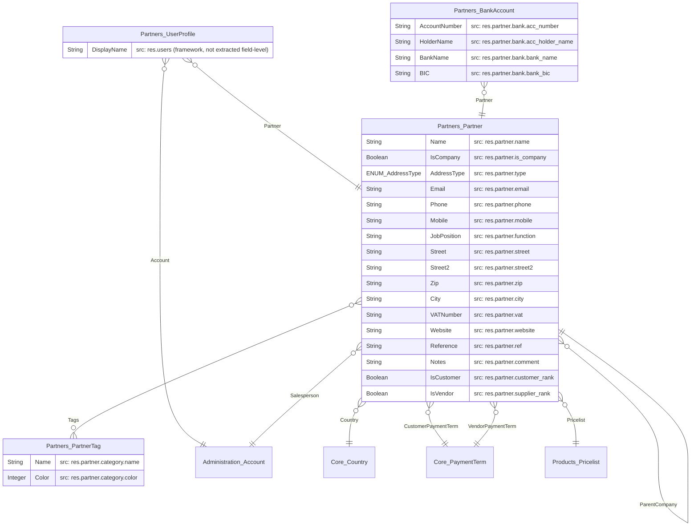
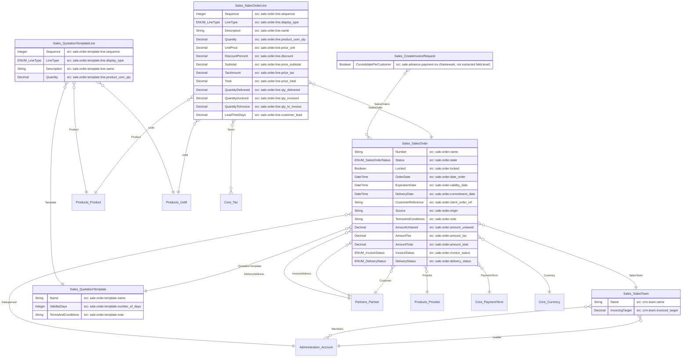
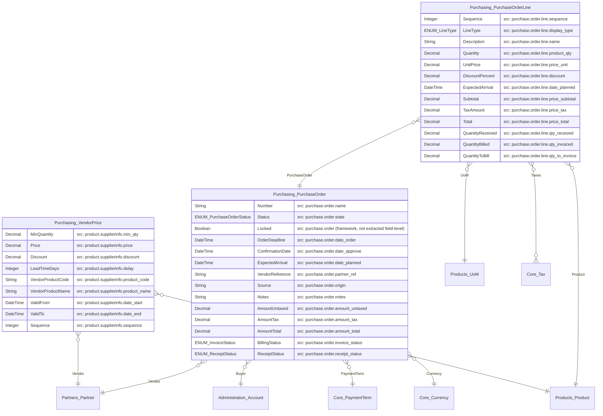
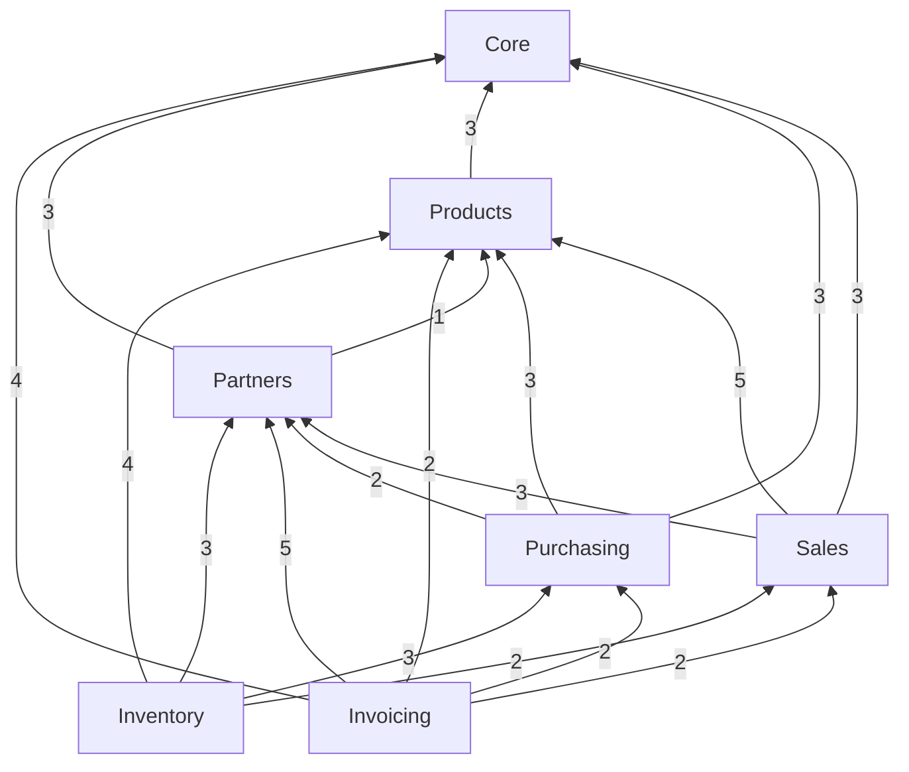

# Target domain ERD — erpv1

Opt-in artifact `erd` (PROJECT.md). Generated by `pipelines/odoo/arch_render.py` from
`brd_spec.py`; do not hand-edit. One diagram per module (owned entities + the entities they reference),
then the cross-module overview. `}o--||` = many-to-one Reference; `}o--o{` = ReferenceSet.

## Core (8 entities)

## Products (8 entities)

## Partners (4 entities)

## Sales (6 entities)

## Purchasing (3 entities)

## Inventory (8 entities)

```mermaid
erDiagram
  Inventory_Warehouse {
    String Name "src: stock.warehouse.name"
    String ShortName "src: stock.warehouse.code"
  }
  Inventory_Location {
    String Name "src: stock.location.name"
    String FullName "src: stock.location.complete_name"
    ENUM_LocationType LocationType "src: stock.location.usage"
    String Barcode "src: stock.location.barcode"
  }
  Inventory_OperationType {
    String Name "src: stock.picking.type.name"
    ENUM_OperationKind Kind "src: stock.picking.type.code"
    String SequenceCode "src: stock.picking.type.sequence_code"
    Boolean CreateBackorder "src: stock.picking.type.create_backorder"
  }
  Inventory_Transfer {
    String Number "src: stock.picking.name"
    ENUM_TransferStatus Status "src: stock.picking.state"
    DateTime ScheduledDate "src: stock.picking.scheduled_date"
    DateTime DateDone "src: stock.picking.date_done"
    DateTime Deadline "src: stock.picking.date_deadline"
    String SourceDocument "src: stock.picking.origin"
    String Notes "src: stock.picking.note"
  }
  Inventory_StockMove {
    String Description "src: stock.move.name"
    ENUM_TransferStatus Status "src: stock.move.state"
    DateTime Date "src: stock.move.date"
    Decimal DemandQuantity "src: stock.move.product_uom_qty"
    Decimal Quantity "src: stock.move.quantity"
    Boolean Picked "src: stock.move.picked"
    String SourceDocument "src: stock.move.origin"
    Boolean IsInventoryAdjustment "src: stock.move.is_inventory"
  }
  Inventory_StockLevel {
    Decimal Quantity "src: stock.quant.quantity"
    Decimal ReservedQuantity "src: stock.quant.reserved_quantity"
    Decimal CountedQuantity "src: stock.quant.inventory_quantity"
    Boolean CountSet "src: stock.quant.inventory_quantity_set"
    DateTime ScheduledCountDate "src: stock.quant.inventory_date"
    DateTime IncomingDate "src: stock.quant.in_date"
  }
  Inventory_ReorderRule {
    String Name "src: stock.warehouse.orderpoint.name"
    Decimal MinQuantity "src: stock.warehouse.orderpoint.product_min_qty"
    Decimal MaxQuantity "src: stock.warehouse.orderpoint.product_max_qty"
    Decimal QuantityMultiple "src: stock.warehouse.orderpoint.qty_multiple"
    Boolean Automatic "src: stock.warehouse.orderpoint.trigger"
  }
  Inventory_ValidateTransferRequest {
    Boolean CreateBackorder "src: stock.backorder.confirmation (framework, not extracted field-level)"
  }
  Inventory_Warehouse }o--|| Inventory_Location : "StockLocation"
  Inventory_Warehouse }o--|| Partners_Partner : "Address"
  Inventory_Location }o--|| Inventory_Location : "Parent"
  Inventory_Location }o--|| Inventory_Warehouse : "Warehouse"
  Inventory_OperationType }o--|| Inventory_Warehouse : "Warehouse"
  Inventory_OperationType }o--|| Inventory_Location : "DefaultSource"
  Inventory_OperationType }o--|| Inventory_Location : "DefaultDestination"
  Inventory_Transfer }o--|| Inventory_OperationType : "OperationType"
  Inventory_Transfer }o--|| Partners_Partner : "Partner"
  Inventory_Transfer }o--|| Inventory_Location : "SourceLocation"
  Inventory_Transfer }o--|| Inventory_Location : "DestinationLocation"
  Inventory_Transfer }o--|| Inventory_Transfer : "Backorder"
  Inventory_Transfer }o--|| Sales_SalesOrder : "SalesOrder"
  Inventory_Transfer }o--|| Purchasing_PurchaseOrder : "PurchaseOrder"
  Inventory_Transfer }o--|| Administration_Account : "Responsible"
  Inventory_StockMove }o--|| Inventory_Transfer : "Transfer"
  Inventory_StockMove }o--|| Products_Product : "Product"
  Inventory_StockMove }o--|| Products_UoM : "UoM"
  Inventory_StockMove }o--|| Inventory_Location : "SourceLocation"
  Inventory_StockMove }o--|| Inventory_Location : "DestinationLocation"
  Inventory_StockMove }o--|| Sales_SalesOrderLine : "SalesOrderLine"
  Inventory_StockMove }o--|| Purchasing_PurchaseOrderLine : "PurchaseOrderLine"
  Inventory_StockLevel }o--|| Products_Product : "Product"
  Inventory_StockLevel }o--|| Inventory_Location : "Location"
  Inventory_ReorderRule }o--|| Products_Product : "Product"
  Inventory_ReorderRule }o--|| Inventory_Location : "Location"
  Inventory_ReorderRule }o--|| Partners_Partner : "Vendor"
  Inventory_ReorderRule }o--o{ Purchasing_PurchaseOrder : "PurchaseOrders"
  Inventory_ValidateTransferRequest }o--|| Inventory_Transfer : "Transfer"
```

## Invoicing (6 entities)

```mermaid
erDiagram
  Invoicing_Invoice {
    String Number "src: account.move.name"
    ENUM_InvoiceType InvoiceType "src: account.move.move_type"
    ENUM_InvoiceStatus Status "src: account.move.state"
    ENUM_PaymentStatus PaymentStatus "src: account.move.payment_state"
    DateTime InvoiceDate "src: account.move.invoice_date"
    DateTime DueDate "src: account.move.invoice_date_due"
    String Reference "src: account.move.ref"
    String PaymentReference "src: account.move.payment_reference"
    String SourceDocument "src: account.move.invoice_origin"
    String Notes "src: account.move.narration"
    Decimal AmountUntaxed "src: account.move.amount_untaxed"
    Decimal AmountTax "src: account.move.amount_tax"
    Decimal AmountTotal "src: account.move.amount_total"
    Decimal AmountDue "src: account.move.amount_residual"
  }
  Invoicing_InvoiceLine {
    Integer Sequence "src: account.move.line.sequence"
    ENUM_LineType LineType "src: account.move.line.display_type"
    String Description "src: account.move.line.name"
    Decimal Quantity "src: account.move.line.quantity"
    Decimal UnitPrice "src: account.move.line.price_unit"
    Decimal DiscountPercent "src: account.move.line.discount"
    Decimal Subtotal "src: account.move.line.price_subtotal"
    Decimal Total "src: account.move.line.price_total"
  }
  Invoicing_Payment {
    String Number "src: account.payment.name"
    ENUM_PaymentDirection Direction "src: account.payment.payment_type"
    ENUM_PartnerKind PartnerKind "src: account.payment.partner_type"
    Decimal Amount "src: account.payment.amount"
    DateTime PaymentDate "src: account.payment.date"
    String Memo "src: account.payment.memo"
    ENUM_PaymentState Status "src: account.payment.state"
    ENUM_PaymentMethod Method "src: account.payment (framework, not extracted field-level)"
  }
  Invoicing_PaymentAllocation {
    Decimal Amount
  }
  Invoicing_RegisterPaymentRequest {
    Decimal Amount "src: account.payment.register.amount"
    DateTime PaymentDate "src: account.payment.register.payment_date"
    String Memo "src: account.payment.register.communication"
    ENUM_PaymentMethod Method "src: account.payment.register (framework, not extracted field-level)"
  }
  Invoicing_CreditNoteRequest {
    String Reason "src: account.move.reversal.reason"
    DateTime ReversalDate "src: account.move.reversal.date"
  }
  Invoicing_Invoice }o--|| Partners_Partner : "Partner"
  Invoicing_Invoice }o--|| Partners_Partner : "DeliveryAddress"
  Invoicing_Invoice }o--|| Administration_Account : "Salesperson"
  Invoicing_Invoice }o--|| Core_PaymentTerm : "PaymentTerm"
  Invoicing_Invoice }o--|| Core_Currency : "Currency"
  Invoicing_Invoice }o--|| Invoicing_Invoice : "ReversalOf"
  Invoicing_Invoice }o--|| Partners_BankAccount : "BankAccount"
  Invoicing_Invoice }o--o{ Sales_SalesOrder : "SalesOrders"
  Invoicing_Invoice }o--|| Purchasing_PurchaseOrder : "PurchaseOrder"
  Invoicing_InvoiceLine }o--|| Invoicing_Invoice : "Invoice"
  Invoicing_InvoiceLine }o--|| Products_Product : "Product"
  Invoicing_InvoiceLine }o--|| Products_UoM : "UoM"
  Invoicing_InvoiceLine }o--o{ Core_Tax : "Taxes"
  Invoicing_InvoiceLine }o--o{ Sales_SalesOrderLine : "SalesOrderLines"
  Invoicing_InvoiceLine }o--|| Purchasing_PurchaseOrderLine : "PurchaseOrderLine"
  Invoicing_Payment }o--|| Partners_Partner : "Partner"
  Invoicing_Payment }o--|| Core_Currency : "Currency"
  Invoicing_Payment }o--|| Partners_BankAccount : "BankAccount"
  Invoicing_Payment }o--o{ Invoicing_Invoice : "Invoices"
  Invoicing_PaymentAllocation }o--|| Invoicing_Payment : "Payment"
  Invoicing_PaymentAllocation }o--|| Invoicing_Invoice : "Invoice"
  Invoicing_RegisterPaymentRequest }o--o{ Invoicing_Invoice : "Invoices"
  Invoicing_CreditNoteRequest }o--|| Invoicing_Invoice : "Invoice"
```

## Cross-module overview (module → module, association count)

